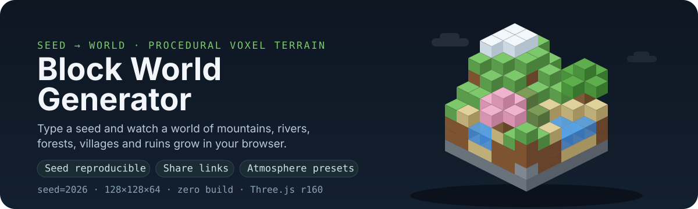
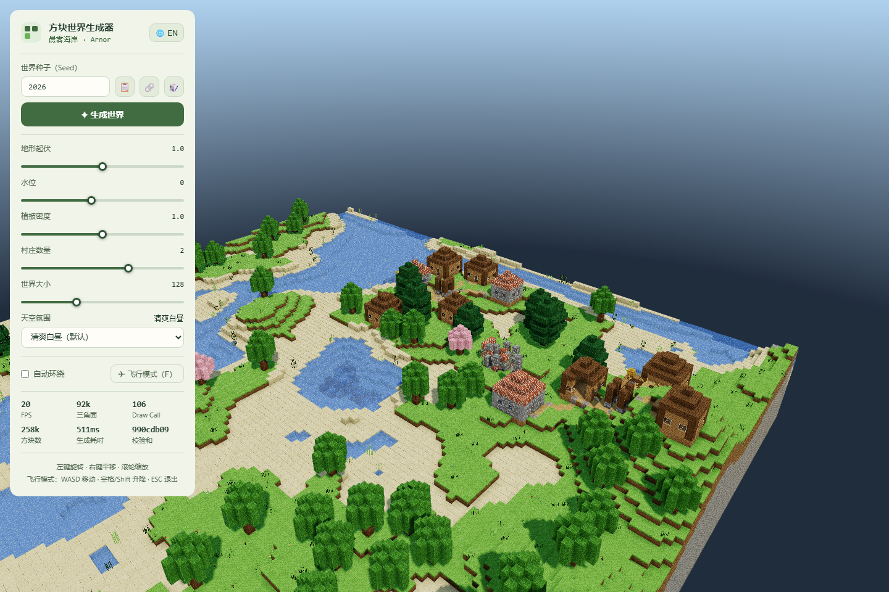
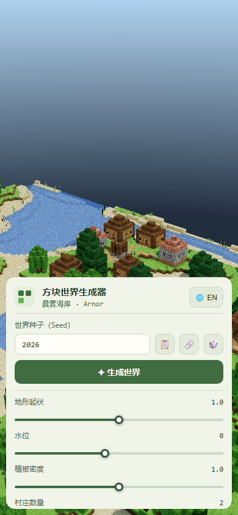

<p align="center"><a href="README.md">简体中文</a> · English</p>

<p align="center">
  
</p>

**Turn a seed into a block world you can orbit or explore in flight.**
Terrain, vegetation, villages and pixel textures are generated locally in your browser. Change the parameters and compare worlds with the displayed checksum.



<details>
<summary>View the mobile interface</summary>



</details>

[](https://github.com/LINYEANSHU/3d-world-generator/actions/workflows/ci.yml)
[MIT](LICENSE) · Three.js r160 · No build step · English / 中文

## From seed to landscape

- **Reproducible terrain**: the same version, seed and generation parameters produce the same voxel data, with a checksum shown in the panel.
- **Adjustable scenery**: change terrain relief, water level, vegetation, target village count and world size.
- **Shareable parameters**: a URL hash stores the seed and generation settings for automatic loading; choose the atmosphere separately.
- **Free observation**: orbit, pan and zoom with the mouse, or enter first-person flight on desktop.
- **Three atmospheres**: day, dusk and overcast change the sky, fog and lighting.

## Run locally

Clone the repository and start a static server from the project directory (Python 3 required):

```bash
git clone https://github.com/LINYEANSHU/3d-world-generator.git
cd 3d-world-generator
python -m http.server 8137 --bind 127.0.0.1
```

Open **http://127.0.0.1:8137**. On Windows, `start.bat` searches for Python, the `py` launcher, then Node.js through `npx`, and opens the page.

The app uses ES Modules and an import map, so serve it over HTTP. Three.js and OrbitControls are bundled; the Python launch path needs no runtime downloads.

### Your first world

1. Keep the default seed `2026` and wait for generation to finish.
2. Left-drag to orbit, right-drag to pan and scroll to inspect the villages and rivers.
3. Change one generation setting, click **Generate World**, and compare the scenery and checksum.
4. Copy a parameter link with the link button. The recipient must be able to reach that deployment; `127.0.0.1` refers to their own computer.

## Controls and parameters

| Action | Control |
| --- | --- |
| Generate / random seed | Enter or **Generate World** / dice button |
| Copy seed / parameter link | Clipboard / link button beside the seed |
| Flight | `F` or flight button; `WASD` to move, `Space` / `Shift` to ascend / descend, `Esc` to exit |
| Auto-orbit / atmosphere / language | Checkbox / dropdown / language button |

| Parameter | Range | Default |
| --- | --- | --- |
| Terrain relief | 0–2, step 0.1 | 1.0 |
| Water-level offset | −3–4, step 1 | 0 |
| Vegetation density | 0–2, step 0.1 | 1.0 |
| Target village count | 0–3 | 2 |
| World edge length | 96 / 128 / 160 / 192 blocks | 128 |

## How generation works

`Seed → noise height field → rivers and surfaces → plants and structures → chunk meshes → Three.js`

The height field combines fBm and ridged noise. Rivers and lakes are carved before surfaces are assigned by elevation and slope. Structures use flat-site selection for villages, followed by trees, watchtowers and ruins. Meshing uses 16×16 chunks, interior-face culling, vertex ambient occlusion and merged geometry; repeated plants use instancing.

| Source | Responsibility |
| --- | --- |
| [generator.js](js/generator.js) / [structures.js](js/structures.js) | Terrain and structures |
| [world.js](js/world.js) / [mesher.js](js/mesher.js) | Voxel storage and meshing |
| [scene.js](js/scene.js) / [main.js](js/main.js) | Rendering, camera, UI and sharing |
| [atlas.js](js/atlas.js) / [i18n.js](js/i18n.js) | Procedural textures and bilingual text |

## Development checks

CI uses Node.js 22 to syntax-check every script in `js/`. The PowerShell equivalent is:

```powershell
Get-ChildItem js -Recurse -Filter *.js | ForEach-Object { node --check $_.FullName; if ($LASTEXITCODE) { throw $_.FullName } }
```

Syntax checks do not verify WebGL output, generation speed or cross-browser behavior.

## Scope and limits

Use a modern browser with WebGL, ES Modules and import-map support. Larger worlds need more memory and generation time, and frame rate depends on the device. Village counts depend on suitable sites. Flight uses a keyboard and Pointer Lock; orbiting is more suitable for touch devices. The app generates finite scenes; block editing and save-file export are not provided.

## Contributors

- [LINYEANSHU](https://github.com/LINYEANSHU)

## License and third-party notices

[MIT](LICENSE) © 2026 LINYEANSHU.

`lib/three.module.min.js` and `lib/OrbitControls.js` come from [Three.js r160](https://github.com/mrdoob/three.js/tree/r160), under the MIT license, copyright the Three.js authors. The visual style is inspired by Minecraft. This project is unaffiliated with Mojang / Microsoft; textures are generated with Canvas and contain no game assets from them.
