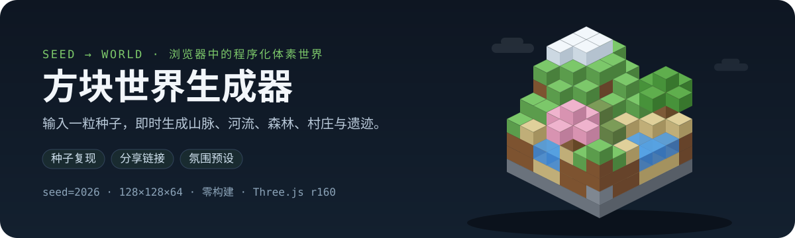

<p align="center">简体中文 · <a href="README.en.md">English</a></p>

<p align="center">
  
</p>

<p align="center">
  <a href="https://github.com/LINYEANSHU/3d-world-generator/actions/workflows/ci.yml"></a>
  <a href="LICENSE"></a>
  
  
</p>

**方块世界生成器**是一个纯前端的 3D 体素世界生成器：输入任意种子（Seed），浏览器里即时
长出一座包含山脉、平原、河流、湖泊、森林、村庄、了望塔与遗迹的微缩方块世界。所有地形都在
本地程序化生成——无后端、无构建步骤、无外部图片资源（贴图由 Canvas 逐像素绘制），
支持环绕观察与第一人称飞行，界面提供中文 / English 双语切换。

## 特性

- **种子复现** —— 相同种子 + 相同参数，永远得到同一个世界（面板底部校验和可验证）；全程不使用 `Math.random()`
- **分享链接** —— 一键把种子与全部参数编码进 URL `#` 号后，发给对方即自动载入同一世界
- **生物群系与结构** —— 橡木 / 白桦 / 云杉 / 樱花林、雪线、沙滩、苔石遗迹、山腰了望塔、带农田与水井的村庄
- **氛围预设** —— 清爽白昼 / 暖阳黄昏 / 烟雨迷蒙，一键切换天空渐变、雾色与光照，不改动世界内容
- **界面双语** —— 中文 / English 一键切换，默认跟随浏览器语言
- **性能友好** —— 区块化网格合并 + 顶点环境光遮蔽（AO），128³ 世界在普通桌面浏览器 60 FPS

## 快速开始

```bash
git clone https://github.com/LINYEANSHU/3d-world-generator.git
cd 3d-world-generator
```

**方式一（推荐，Windows）**：双击 `start.bat`，自动启动本地服务器并打开浏览器。

**方式二（任意平台）**：启动任意静态服务器后访问 `http://127.0.0.1:8137`：

```bash
npx -y http-server -p 8137
# 或：python -m http.server 8137
```

> **为什么需要本地服务器？** 页面使用 ES Modules + importmap 加载代码，浏览器的
> 同源策略不允许 `file://` 协议下的模块导入，因此直接双击 `index.html` 无法运行，
> 必须通过 HTTP 访问（本地服务器即可，无需联网）。

## 操作说明

| 操作 | 方式 |
| --- | --- |
| 旋转 / 平移 / 缩放 | 鼠标左键拖动 / 右键拖动 / 滚轮 |
| 生成世界 | 输入种子 → 点「生成世界」或按回车 |
| 随机世界 | 点 🎲 按钮 |
| 复制种子 / 分享链接 | 点 📋 / 🔗 按钮（生成后地址栏也自动带上全部参数） |
| 天空氛围 | 下拉切换三种预设，即时生效 |
| 飞行模式 | 按 `F` 或点按钮；`WASD` 移动，`空格`/`Shift` 升降，`ESC` 退出 |
| 界面语言 | 点面板右上角 🌐 按钮（中文 / English），默认跟随浏览器语言 |

## 生成参数

| 参数 | 范围 | 默认 | 作用 |
| --- | --- | --- | --- |
| 世界种子 | 任意文本 | `2026` | 唯一决定整个世界；留空时自动填入随机数并回显 |
| 地形起伏 | 0 – 2（步长 0.1） | 1.0 | 山脊噪声振幅，0 = 平原，2 = 险峻高山 |
| 水位 | -3 – +4（步长 1） | 0 | 全局海平面偏移，正值扩大海洋与湖泊 |
| 植被密度 | 0 – 2（步长 0.1） | 1.0 | 树木 / 花草 / 蘑菇 / 芦苇的散布倍率 |
| 村庄数量 | 0 – 3（步长 1） | 2 | 目标数量，实际取决于能否找到平坦选址 |
| 世界大小 | 96 / 128 / 160 / 192 | 128 | 地图边长（方块数），同时影响雾效 / 阴影 / 相机 |
| 天空氛围 | day / dusk / overcast | day | 仅改变天空、雾与光照，不改变地形与结构 |

## 架构简述

### 生成管线

1. **高度场** —— 大陆 fBm + 丘陵 fBm + 山地遮罩 × ridged 山脊噪声，频率随世界尺寸选取；
2. **高度归一** —— 温和仿射重映射，避免个别种子全图过缓或过陡；
3. **河湖雕刻** —— 湖盆下陷；河道取域扭曲噪声零线，宽度阈值由噪声分位数运行时自校准；
4. **水位平衡** —— 二分搜索整体位移，把水域比例收敛到约 30%（任何种子都有海陆）；
5. **地表铺装** —— 按海拔 / 坡度 / 温度分配草、雪、石、沙滩与水下砂砾，山脊线以上积雪；
6. **结构放置** —— 村庄平坦度评分选址 + 地基整平，了望塔占据山腰高地，遗迹散布低地并随机苔化。

全部随机性由 `种子字符串 → xmur3 哈希 → mulberry32 PRNG / 坐标哈希` 派生，结果完全可复现。

### 网格化与渲染

- 世界按 16×16 分区块，逐区块生成网格、分帧构建；
- 相邻实体方块间内部面全部剔除（体素级面剔除）；
- 网格化热路径：邻块查询内联为列基址 + 数组直读，遮挡与贴图槽位走预计算
  **查找表（LUT）**，AO 等级复用暂存数组——同环境实测网格化提速约 1/3；
- 逐顶点 **AO** + 四叉翻转消除各向异性插值，方块棱角柔和立体；
- 每区块合并为 1 份 solid + 1 份 water `BufferGeometry`，全场景约 120 个 Draw Call；
- 花草 / 麦子 / 云层用 `InstancedMesh` 批量渲染；世界静止，阴影贴图只渲染一次（零持续开销）；
- 体素存储为 `Uint8Array` 列主序布局。

### 目录结构

```
3d-world-generator/
├── index.html          入口（UI + importmap）
├── start.bat           一键启动脚本（Windows）
├── css/style.css       界面样式
├── js/
│   ├── i18n.js         界面中英文案与语言切换
│   ├── noise.js        种子随机数（xmur3/mulberry32）+ Perlin/fBm/ridged 噪声
│   ├── blocks.js       方块注册表（ID、贴图槽位查找表、剔除属性）
│   ├── atlas.js        程序化像素纹理图集（Canvas 2D 绘制）
│   ├── world.js        体素数据结构（列主序 Uint8Array）
│   ├── generator.js    地形生成（高度场 / 河湖雕刻 / 生物群系铺装）
│   ├── structures.js   树木 / 花草 / 村庄 / 了望塔 / 遗迹
│   ├── mesher.js       区块网格化（面剔除 + 顶点 AO + 合并网格）
│   ├── scene.js        渲染（光照 / 阴影 / 天空 / 相机 / 飞行 / 氛围预设）
│   └── main.js         应用编排（UI 绑定 / 生成流程 / 分享链接 / 统计）
└── lib/                Third-party bundled files（见下）
```

## 第三方依赖（lib/）

| 文件 | 来源 | 许可证 |
| --- | --- | --- |
| `lib/three.module.min.js` | [three.js](https://github.com/mrdoob/three.js) r160 构建产物 | MIT |
| `lib/OrbitControls.js` | three.js `examples/jsm/controls` 控件 | MIT |

为便于离线运行，这两个文件以本地副本随仓库分发，版权归原作者所有。

## 参考与致谢

- 视觉风格受 [Minecraft](https://www.minecraft.net/) 启发——本项目与 Mojang / Microsoft
  无关，不含任何游戏素材，全部纹理均由 Canvas 程序化绘制；
- [Three.js](https://threejs.org/)（MIT）承担全部渲染。

## 许可证

[MIT](LICENSE) © 2026 LINYEANSHU
